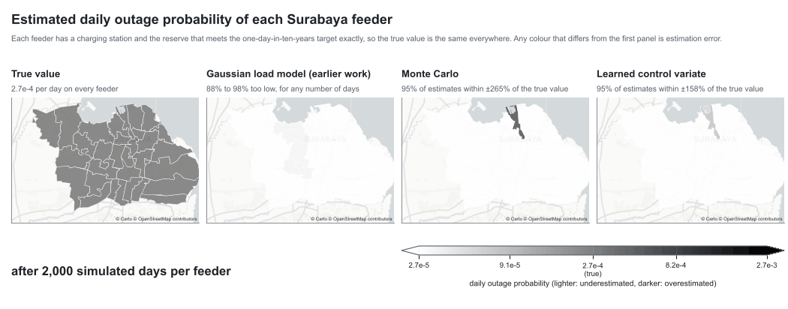

# Learned control variates for rare grid-outage estimation

Code and data for

> S. Iyanda and M. M. Arief, "Learned Control Variates for Rare Grid-Outage Estimation at
> Electric Vehicle Charging Stations," *10th International Conference on Smart Grid and
> Smart Cities (ICSGSC 2026)*, Guangzhou, China, 2026.

A public EV charging station adds load to a distribution feeder, and on rare days the feeder
overloads. Planners need the probability of such a day, often 1e-3 to 1e-6, but plain Monte
Carlo needs about 400/θ runs of an expensive grid simulator to reach a 10% relative error. The
paper builds a control variate from a classifier of the outage trained on cheap features
(temperature, load forecast, storm flag) and shows that its variance reduction is set by the
classifier's recall and precision on the rare days. Every number, figure and table of the paper
can be regenerated from this repository.

<p align="center">
  <picture>
    <source media="(prefers-color-scheme: dark)" srcset="figures/relerr_map_dark.gif">
    
  </picture>
</p>

*Each feeder has a charging station and the reserve that meets the one-day-in-ten-years target
exactly, so the true outage probability (2.7e-4 per day) is the same everywhere. The Gaussian
load model of the earlier work underestimates it by 88% to 98% on every feeder, whatever the
number of simulated days. After 10^5 simulated days per feeder, 95% of the Monte Carlo estimates
are within ±37% of the truth and 95% of the learned-control-variate estimates within ±23%; after
10^6 days, ±13% and ±7%.*

## Quick start

```bash
git clone https://github.com/ai-vnv/learned-control-variates-rare-outages
cd learned-control-variates-rare-outages
python -m pip install -e ".[test]"     # numpy, scipy, scikit-learn, matplotlib, pillow, pytest
make test                              # checks of Theorems 1 and 3, Corollary 1, Proposition 1 (seconds)
make figures                           # rebuild figures/ and tables/ from the stored results/ (seconds)
make numbers                           # print every number quoted in the paper
```

`make all` reruns every simulation from scratch (about one hour on two cores) and then
rebuilds the figures, the animation and the numbers. All runs use fixed seeds; with the
versions in `requirements.txt` the stored results are reproduced exactly.

## What reproduces what

| Paper | Script (simulation → figure) | Output |
|---|---|---|
| Fig. 1(a), Fig. 1(c), Table I, checks in Sec. V-B | `run_experiments.py` → `make_figures.py`, `make_tables.py` | `results/results.json`, `figures/fig_ablation.pdf`, `tables/tab_ablation.tex` |
| Fig. 1(b): running estimate over 400 replications | `run_running_multi.py 400` → `make_figures.py` | `results/running_multi.json` |
| Sec. V-C: Embong Wungu reserve and over-design | `run_surabaya.py` → `make_surabaya.py` | `results/surabaya.json` |
| Fig. 2 and Table II: blackout map of Surabaya | `run_map.py` → `make_map.py` | `results/map.json`, `figures/fig_map.pdf`, `tables/tab_map.tex` |
| Animated map above | `run_relerr.py` → `make_gif.py` | `results/relerr.json`, `figures/relerr_map_*.gif` |
| Every number in the text | `report_numbers.py` | `results/paper_numbers.md` |

`results/results.json` also holds the checks reported with the code in the paper: the
Theorem 1 threshold sweep (`E1`), the few-outage regime (`E3`), the unlabelled pool (`E4`) and the
ceiling against the unobserved noise (`E5`); `make_figures.py` draws them in
`figures/fig_theory_check.pdf` and `figures/fig_regimes.pdf`.

## Repository layout

```
src/lcv/        simulator with exact θ and η(x) by quadrature, importance-sampling evaluator of ρ²,
                the controls (Gaussian proxy, stump, linear, boosted trees, Bayes posterior),
                control-variate estimators, data loaders, figure style
scripts/        run_*.py simulations, make_*.py figures and tables, fetch_boundaries.py
data/           Surabaya case study (see data/README.md)
results/        stored outputs of every run_*.py
figures/, tables/   generated figures (PDF with embedded TrueType fonts, PNG) and LaTeX tables
tests/          fast checks of the analytical results
```

## The method in a few lines

```python
import numpy as np, lcv
sim = lcv.Simulator().calibrate(1e-3)                  # outage probability 1e-3 per simulated day
X, S, Y = sim.sample(500_000, np.random.default_rng(0))   # features, severity, outage indicator
t = 3.1                                                # stump: alarm on a hot day, x1 >= t
C = (X[:, 0] >= t).astype(float)
print(lcv.mc_estimate(Y))                              # (estimate, standard error)
print(lcv.cv_estimate(Y, C, gamma=float(lcv.Phibar(t))))  # (estimate, standard error, beta, rho^2)

ev = lcv.ISEvaluator(sim, n=2_000_000, seed=1)         # exact evaluation of the control
Ce = (ev.X[:, 0] >= t).astype(float)
recall, fpr, precision, gamma = ev.binary_rates(Ce, EC=float(lcv.Phibar(t)))
print(ev.rho2(Ce, EC=gamma)[0], recall * precision)    # 0.273 and 0.274: Corollary 1
```

For a binary learner with recall τ and false-positive rate φ, the variance ratio to Monte
Carlo is 1 − ρ² with ρ² = (τ − φ)² θ(1 − θ) / (γ(1 − γ)), i.e., one minus the squared Matthews
correlation of the learner, which tends to 1 − recall × precision as θ → 0 (Theorem 1,
Corollary 1).

## Notes

* **Fonts.** The paper figures use Arial, which is not redistributed. Point the environment
  variable `LCV_FONT_DIR` to a folder with `Arial.ttf` to get identical figures; otherwise
  Liberation Sans, Arimo or DejaVu Sans is used. PDFs always embed TrueType (Type 42) fonts.
* **Map boundaries.** `make figures` and `make gif` first run `scripts/fetch_boundaries.py`,
  which downloads the GADM 4.1 sub-district polygons (about 13 MB, checked by hash). GADM does
  not allow redistribution, so they are not in the repository.
* **Synthetic simulator.** The feeder simulator is synthetic so that the exact outage
  probability and the Bayes posterior are known; the estimators never use them. In the Surabaya
  case it is calibrated to the reliability reported for each feeder, but the shape of its tail is
  assumed.

## Citation

See `CITATION.cff`. The Surabaya data and the earlier robust station-location model are from
Y. P. Akhra, I. Vanany and M. Arief, "A robust electric vehicle charging station optimization
under rare event disruptions," arXiv:2307.05470, and
[ai-vnv/rare-event-ev-charging](https://github.com/ai-vnv/rare-event-ev-charging).

## Licence

Code: MIT (see `LICENSE`). Data: see `data/README.md`.
